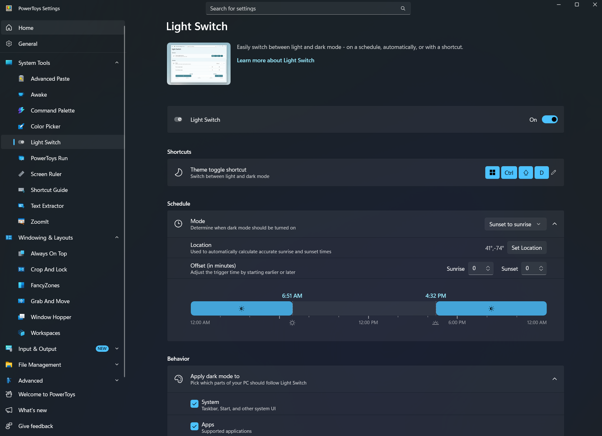

# Automatic Dark (or Light) Mode on Windows 11

Microsoft includes a dedicated Light Switch utility inside PowerToys, its official Windows enhancement suite.

- Install PowerToys: Download it from the Microsoft Store or install via Windows Terminal (winget install Microsoft.PowerToys).
- Enable Light Switch: Open PowerToys, select Light Switch in the left sidebar (under System Tools), and toggle Enable Light Switch to On.
- Set your schedule: Under Schedule Mode, choose one of three options:
  - Sunset to Sunrise: Uses your location (or manual coordinates) to switch automatically with local daylight.
  - Fixed hours: Lets you pick exact times for Light and Dark mode.
  - Follow Night Light: Syncs directly with your existing Windows Night Light schedule.
- Choose what changes: Under Apply dark mode to, pick System and Apps (or just one of the two). You can also bind a custom keyboard shortcut to toggle themes manually anytime.

 
 
